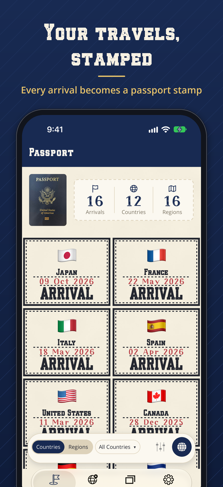
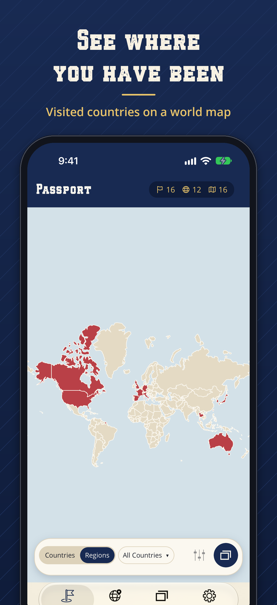
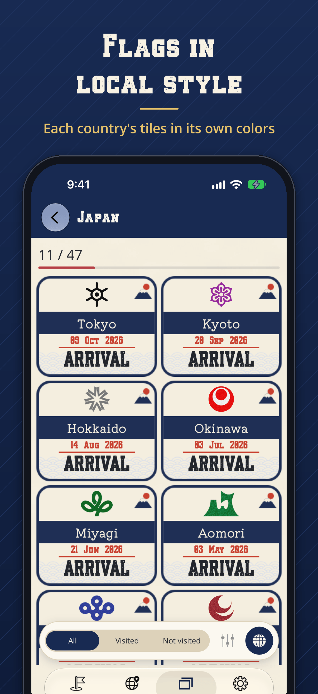
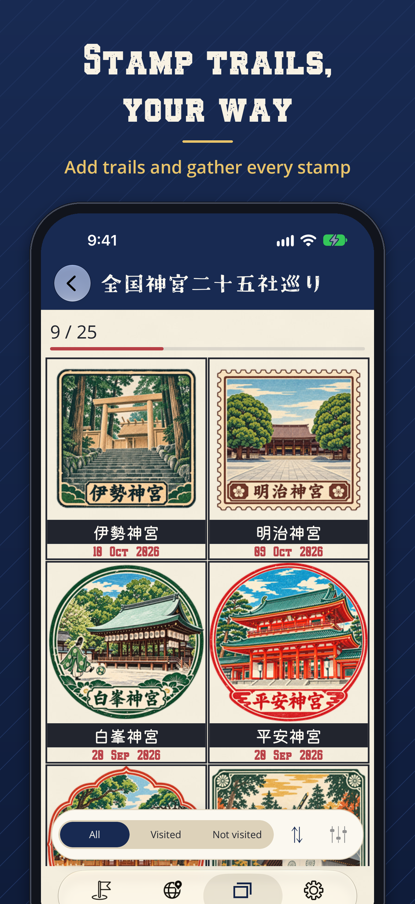

# FlagsRally

Collect the countries and regions you visit as passport stamps.

FlagsRally is a travel log for iPhone, iPad and Android. When you arrive somewhere, the app stamps your passport with the country and region, adds the region's flag to your collection and puts the place on your world map. Stamp trails add places to visit, such as shrines or stations, where you check in when you are within 50 m.

[日本語](#日本語)

<p>




</p>

## Download

- [App Store](https://apps.apple.com/app/id6504290042) (iPhone and iPad)
- [Google Play](https://play.google.com/store/apps/details?id=com.companyname.flagsrally) (Android)

## Features

- **Passport**: a stamp for each country and region you arrive in, in fourteen designs.
- **Map**: your arrivals and the places of your stamp trails, with check-in when you are near.
- **Collections**: regional flags for each country (fifteen countries' tiles drawn in their own style), and your progress on each stamp trail.
- **Stamp trails**: add them from the shared list or from a JSON file.
- **No account**: your records stay on your device. You can back them up to a password-protected file.

The first 5 arrivals are free. A subscription, or your own Google Maps API key, lifts the limit.

## Building

The app is built with .NET 10 MAUI.

```bash
dotnet test FlagsRally_xunit/FlagsRally_xunit/FlagsRally_xunit.csproj
dotnet build FlagsRally.csproj -f net10.0-android -t:Install   # build and install on an Android emulator
```

`Repository/Constants.cs` holds placeholder API keys (Google Maps, TomTom, RevenueCat and others). Put in your own to get maps, place lookup and subscriptions working. Do not commit real keys.

Release notes are in [CHANGELOG.md](CHANGELOG.md).

## Terms and privacy

- Terms of Use: [English](https://ken-mro.github.io/FlagsRally/terms/en/) / [日本語](https://ken-mro.github.io/FlagsRally/terms/ja/)
- Privacy Policy: [English](https://ken-mro.github.io/FlagsRally/privacy/en/) / [日本語](https://ken-mro.github.io/FlagsRally/privacy/ja/)

The pages are published from [`docs/`](docs/) with GitHub Pages.

## License

The source code is released under the [MIT License](LICENSE.txt).

The fonts in `Resources/Fonts` and other third-party materials are under their own licenses. The MIT License does not cover the FlagsRally name; please do not publish another app under it.

---

## 日本語

訪れた国や地域を、パスポートのスタンプとして集めるアプリです（iPhone・iPad・Android）。

到着を記録すると、パスポートに国と地域のスタンプが押されます。あわせて、地域の旗がコレクションに加わり、世界地図にその場所が載ります。スタンプラリーを追加すると、神社や駅など訪れる地点が地図に出て、50 m 以内に近づくとチェックインできます。

- ダウンロード：[App Store](https://apps.apple.com/app/id6504290042)・[Google Play](https://play.google.com/store/apps/details?id=com.companyname.flagsrally)
- 到着の記録は 5 件まで無料です。サブスクリプションに登録するか、ご自身の Google Maps API キーを入力すると、制限がなくなります。
- アカウントは不要です。記録は端末の中に保存されます。
- [利用規約](https://ken-mro.github.io/FlagsRally/terms/ja/)・[プライバシーポリシー](https://ken-mro.github.io/FlagsRally/privacy/ja/)
- ソースコードは [MIT ライセンス](LICENSE.txt)で公開しています。フォントなど第三者の素材にはそれぞれのライセンスが適用されます。FlagsRally の名称は MIT ライセンスの対象ではありません。
